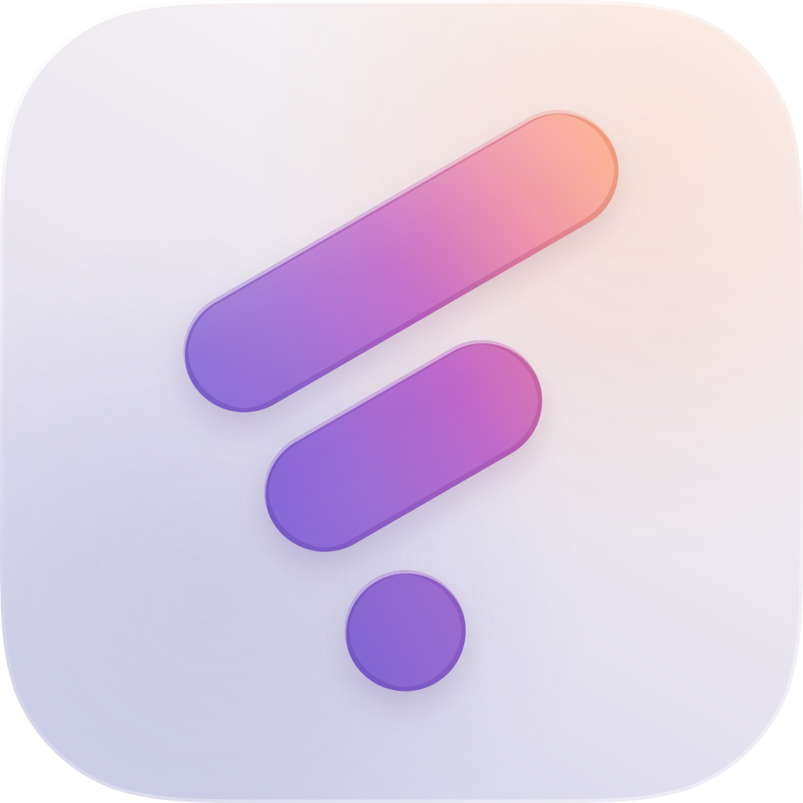

# SeasonCat

基于 Concord 内核的安卓代理客户端，界面简洁、占用内存少，开源无广告。

[English](#english)

## 简介

SeasonCat（包名 `season.us.ci.cat`）是 [FlClash](https://github.com/chen08209/FlClash) 的衍生项目：

- **引用 FlClash**：代码基于 FlClash v0.9.5-rs.1（[chen08209/FlClash@bdf83ca](https://github.com/chen08209/FlClash/commit/bdf83ca)），保留其 Kotlin VPN 服务、内核接入和配置逻辑。感谢 FlClash 作者和贡献者。
- **内核**：[Concord](https://github.com/chen08209/concord)（Rust），支持规则分流、代理组、延迟测试和 TUN 模式。
- **界面用 Slint**：用 [Slint](https://slint.dev) 重写界面，扁平、无毛玻璃，主题色与 FlClash 一致（默认 `#007AFF`，另有 7 种强调色），支持浅色和深色。

## 状态

- 界面已全部改为 Slint，Flutter 已移除。
- 先支持安卓 arm64，桌面端以后再说。

## 架构

- Kotlin 薄壳（`NativeActivity`）负责 VPN 授权和启停，复用 FlClash 的 VPN 服务。
- Rust + Slint 界面通过本地 socket 与壳和内核通信，Rust 代码不直接调用 JNI。

## 许可证

GPL-3.0-or-later，与 FlClash 相同，见 [LICENSE](LICENSE)。Slint 按其 GPLv3 授权使用。

---

## English

SeasonCat is an Android proxy client derived from [FlClash](https://github.com/chen08209/FlClash)
(v0.9.5-rs.1, chen08209/FlClash@bdf83ca), using the [Concord](https://github.com/chen08209/concord) core.
The UI is written in [Slint](https://slint.dev): flat, simple, low memory,
with FlClash's theme colors. Flutter has been removed.
Licensed under GPL-3.0-or-later, like FlClash.
