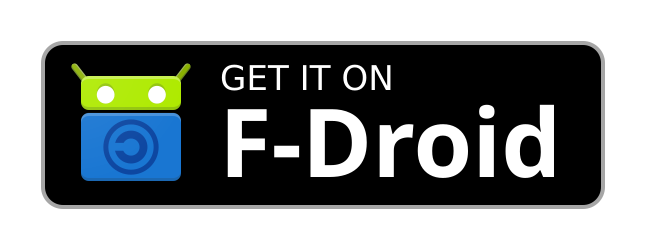

<div align="center">


# FlClash

A multi-platform proxy client based on the Concord core. Simple to use, open source and ad-free.

**English** · [简体中文](README_zh_CN.md)

[](https://github.com/chen08209/FlClash/releases/latest)
[](https://github.com/chen08209/FlClash/releases)
[](LICENSE)
[](https://t.me/FlClash)

[Website](https://chen08209.github.io/FlClash) · [Download](#download) · [Changelog](CHANGELOG.md) · [Build from source](#build-from-source)

</div>

<p align="center">
  <picture>
    <source media="(prefers-color-scheme: dark)" srcset="snapshots/preview-dark.png">
    
  </picture>
</p>

## Features

- **One app for Android, Windows, macOS and Linux**, with x64 and ARM64 builds on the desktop.
- **Concord core** with rule routing, proxy groups, latency tests, system proxy and TUN mode.
- **Profiles** from a subscription link or a file, with a built-in editor, override scripts, and custom rules,
  proxies and proxy groups.
- **Live views** of connections, requests, DNS queries and logs.
- **Material You design with Apple-style interaction**: dynamic color, light and dark themes, continuous corners,
  sheets that snap between heights, and layouts that adapt from phones to desktops.
- **Backup and restore** through WebDAV or a local file.
- **Platform touches**: a Quick Settings tile, per-app proxy and Android TV support on Android; a tray menu and
  global hotkeys on the desktop.
- **Open source and ad-free**, licensed under GPL-3.0.

## Download

Get the latest build from [GitHub Releases](https://github.com/chen08209/FlClash/releases/latest), or open the
[website](https://chen08209.github.io/FlClash#download), which picks the right file for your device.

| Platform | Packages | Notes |
| --- | --- | --- |
| Android | APK for `arm64` (arm64-v8a), `armv7` (armeabi-v7a) and `amd64` (x86_64) | Most phones use `arm64`. Also on the F-Droid repository below. |
| Windows 10 and later | Installer (`.exe`) or portable `.zip`, for x64 and ARM64 | Pick ARM64 on Snapdragon and other ARM laptops. |
| macOS 12 and later | DMG for Apple Silicon and Intel | Also on Homebrew. |
| Linux | `.deb`, `.rpm` and AppImage, for x64 and ARM64 | See the tray note below. |

<p>
  <a href="https://chen08209.github.io/FlClash-fdroid-repo/repo?fingerprint=789D6D32668712EF7672F9E58DEEB15FBD6DCEEC5AE7A4371EA72F2AAE8A12FD"></a>
  <a href="https://github.com/chen08209/FlClash/releases/latest"></a>
</p>

**Homebrew**

```bash
brew tap chen08209/tap
brew install --cask flclash
```

**Linux tray icon**

The tray icon is a StatusNotifierItem. KDE Plasma, XFCE and most panels show it as is; GNOME needs the
AppIndicator and KStatusNotifierItem Support extension.

**Unattended desktop**

FlClash starts the core only after the disclaimer is accepted. Where nobody can click it, such as a container, set
`FLCLASH_ACCEPT_DISCLAIMER=1` in the app's environment to accept it on first launch.

## Usage

**Import a profile from a link.** Opening a link in this form imports the subscription into FlClash. The `clashmeta://`
and `flclash://` schemes work the same way.

```text
clash://install-config?url=<URL-encoded subscription link>
```

**Automate on Android.** Tasker, MacroDroid and similar apps can start, stop or toggle the proxy by starting an
activity with one of these actions:

```text
com.follow.clash.action.START
com.follow.clash.action.STOP
com.follow.clash.action.TOGGLE
```

From a computer, the same works over adb:

```bash
adb shell am start -a com.follow.clash.action.TOGGLE
```

## Build from source

The Android app is a Slint UI (`ui/`, Rust) inside a Kotlin shell (`android/`), built with Gradle alone. You need
[Rust](https://rustup.rs/) installed through rustup (the version in `ui/rust-toolchain.toml`),
[cargo-ndk](https://github.com/bbqsrc/cargo-ndk), JDK 17, [Gradle](https://gradle.org/install/) (the version in
`android/gradle/wrapper/gradle-wrapper.properties`) and the Android SDK with NDK r28c for the core and NDK r30 for the
UI library.

```bash
git clone --recursive https://github.com/koko123as/LineCat.git
cd LineCat/ui
ANDROID_NDK_HOME=<NDK r30> cargo ndk -t arm64-v8a --platform 24 -o ../android/app/src/main/jniLibs build --release --locked
cd ../android
gradle :app:assembleRelease -Ptarget-platform=android-arm64
```

The APK lands in `android/app/build/outputs/apk/release/`; the core is compiled with cargo as part of the Gradle
build. `.github/workflows/slint-android.yaml` is the reference build, including the environment the UI library needs.
There is no desktop build any more: the Flutter desktop runners were removed with the Flutter UI. `linux/`, `macos/`
and `windows/` keep only the packaging metadata and icons a later desktop client can reuse.

## Support

Starring the repository is the easiest way to support the project. Questions and announcements go to the
[Telegram channel](https://t.me/FlClash); bugs and feature requests go to
[GitHub Issues](https://github.com/chen08209/FlClash/issues).

<a href="https://star-history.com/#chen08209/FlClash&Date">
  <picture>
    <source media="(prefers-color-scheme: dark)" srcset="https://api.star-history.com/svg?repos=chen08209/FlClash&type=Date&theme=dark">
    
  </picture>
</a>

## License

FlClash is released under the [GPL-3.0 license](LICENSE).
