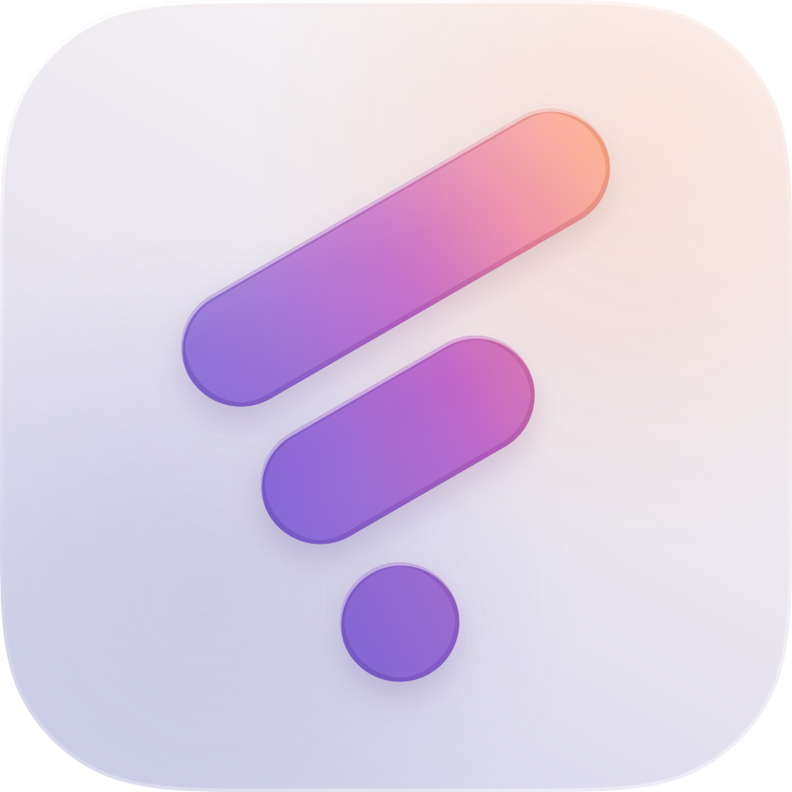

<div align="center">



# FlClash

基于 Concord 内核的多平台代理客户端，简单易用，开源无广告。

[English](README.md) · **简体中文**

[](https://github.com/chen08209/FlClash/releases/latest)
[](https://github.com/chen08209/FlClash/releases)
[](LICENSE)
[](https://t.me/FlClash)

[官网](https://chen08209.github.io/FlClash/zh) · [下载](#下载) · [更新日志](CHANGELOG.md) · [从源码构建](#从源码构建)

</div>

<p align="center">
  <picture>
    <source media="(prefers-color-scheme: dark)" srcset="snapshots/preview-dark.png">
    
  </picture>
</p>

## 功能

- **一个应用覆盖 Android、Windows、macOS 和 Linux**，桌面端同时提供 x64 与 ARM64 版本。
- **Concord 内核**：规则分流、代理组、延迟测试、系统代理与 TUN 模式。
- **配置管理**：通过订阅链接或文件导入配置，内置编辑器，支持覆写脚本以及自定义规则、代理和代理组。
- **实时查看**连接、请求、DNS 查询和日志。
- **Material You 设计，融合 Apple 式交互**：支持动态取色、浅色与深色主题，连续曲率圆角，弹出面板可在几档高度间吸附，布局随屏幕从手机到桌面自适应。
- **备份与恢复**：通过 WebDAV 或本地文件。
- **平台细节**：Android 上有快捷设置磁贴、分应用代理和 Android TV 支持；桌面端有托盘菜单和全局快捷键。
- **开源无广告**，以 GPL-3.0 协议发布。

## 下载

从 [GitHub Releases](https://github.com/chen08209/FlClash/releases/latest) 获取最新版本，或打开
[官网](https://chen08209.github.io/FlClash/zh#download)，它会自动为你的设备选好安装包。

| 平台 | 安装包 | 说明 |
| --- | --- | --- |
| Android | `arm64`（arm64-v8a）、`armv7`（armeabi-v7a）、`amd64`（x86_64）三种 APK | 绝大多数手机选 `arm64`。也可以通过下方的 F-Droid 仓库安装。 |
| Windows 10 及以上 | 安装版（`.exe`）或便携版（`.zip`），分 x64 与 ARM64 | 骁龙等 ARM 架构笔记本选 ARM64。 |
| macOS 12 及以上 | Apple Silicon 与 Intel 两种 DMG | 也可以通过 Homebrew 安装。 |
| Linux | `.deb`、`.rpm` 和 AppImage，分 x64 与 ARM64 | 托盘依赖见下方说明。 |

<p>
  <a href="https://chen08209.github.io/FlClash-fdroid-repo/repo?fingerprint=789D6D32668712EF7672F9E58DEEB15FBD6DCEEC5AE7A4371EA72F2AAE8A12FD"></a>
  <a href="https://github.com/chen08209/FlClash/releases/latest"></a>
</p>

**Homebrew**

```bash
brew tap chen08209/tap
brew install --cask flclash
```

**Linux 托盘图标**

托盘图标是 StatusNotifierItem。KDE Plasma、XFCE 和多数面板直接显示；GNOME 需要安装 AppIndicator and KStatusNotifierItem Support 扩展。

**无人值守的桌面环境**

FlClash 要在免责声明被接受后才会启动核心。在容器等无人点击的环境里，可在应用的环境变量中设置
`FLCLASH_ACCEPT_DISCLAIMER=1`，首次启动时即视为接受。

## 使用

**通过链接导入配置。** 打开下面格式的链接，即可把订阅导入 FlClash。`clashmeta://` 和 `flclash://` 开头的链接同样可用。

```text
clash://install-config?url=<经过 URL 编码的订阅链接>
```

**Android 自动化。** Tasker、MacroDroid 等应用可以用下面的 Action 启动 Activity，从而启动、停止或切换代理：

```text
com.follow.clash.action.START
com.follow.clash.action.STOP
com.follow.clash.action.TOGGLE
```

在电脑上也可以通过 adb 触发：

```bash
adb shell am start -a com.follow.clash.action.TOGGLE
```

## 从源码构建

Android 应用由 Slint 界面（`ui/`，Rust）和 Kotlin 外壳（`android/`）组成，只用 Gradle 构建。需要通过 rustup 安装的
[Rust](https://rustup.rs/)（版本见 `ui/rust-toolchain.toml`）、[cargo-ndk](https://github.com/bbqsrc/cargo-ndk)、JDK 17、
[Gradle](https://gradle.org/install/)（版本见 `android/gradle/wrapper/gradle-wrapper.properties`），以及带 NDK 的
Android SDK：内核用 NDK r28c，界面库用 NDK r30。

```bash
git clone --recursive https://github.com/koko123as/LineCat.git
cd LineCat/ui
ANDROID_NDK_HOME=<NDK r30> cargo ndk -t arm64-v8a --platform 24 -o ../android/app/src/main/jniLibs build --release --locked
cd ../android
gradle :app:assembleRelease -Ptarget-platform=android-arm64
```

APK 输出到 `android/app/build/outputs/apk/release/`，内核在 Gradle 构建中用 cargo 一并编译。完整的参考构建（包括界面库需要的
环境变量）见 `.github/workflows/slint-android.yaml`。目前没有桌面端构建：Flutter 桌面端已随 Flutter 界面一起移除，`linux/`、
`macos/`、`windows/` 只保留以后桌面客户端可复用的打包元数据和图标。

## 支持

给仓库点一个 Star 是支持项目最简单的方式。问题讨论和更新通知请关注 [Telegram 频道](https://t.me/FlClash)，
Bug 与功能建议请提交到 [GitHub Issues](https://github.com/chen08209/FlClash/issues)。

<a href="https://star-history.com/#chen08209/FlClash&Date">
  <picture>
    <source media="(prefers-color-scheme: dark)" srcset="https://api.star-history.com/svg?repos=chen08209/FlClash&type=Date&theme=dark">
    
  </picture>
</a>

## 许可证

FlClash 以 [GPL-3.0 协议](LICENSE)发布。
